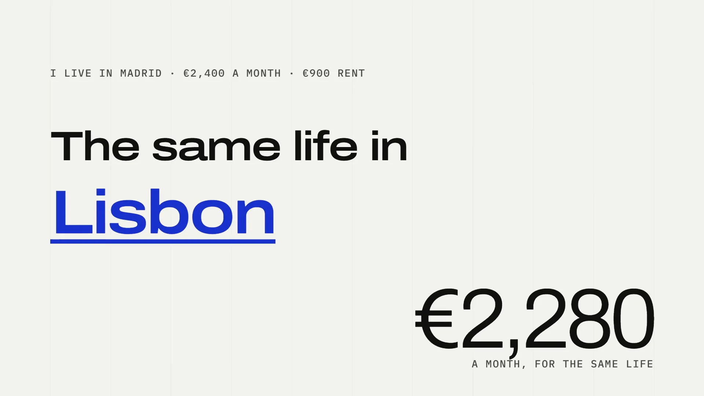

<div align="center">

<a href="https://www.iamdelrio.com"></a>

<sub>(001) — ENGINEER &amp; BUILDER</sub>

# CHRISTIAN DEL RÍO

**FULL-STACK ENGINEER · PRODUCT BUILDER**<br>
SANTANDER — BY DAY · INDIE AI — BY NIGHT

I design, code and launch software products — from critical banking apps to my own AI tools.

[**iamdelrio.com ↗**](https://www.iamdelrio.com) · [LinkedIn](https://www.linkedin.com/in/iamdelrio) · [X / Twitter](https://twitter.com/chrissdelrio) · [hello@iamdelrio.com](mailto:hello@iamdelrio.com)

</div>

---

### (002) — MANIFESTO

> **I BUILD PRODUCTS THAT SHIP. NO DECKS. JUST WORKING SOFTWARE.**

|  |  |
| --- | --- |
| **(A) DAY** | Full-stack developer at Santander, building an internal wholesale lending platform. |
| **(B) NIGHT** | Indie hacker shipping AI-powered products — design, code, launch, support. |
| **(C) ALWAYS** | Building in public since 2023, sharing what works and what doesn't. |

---

### (FEATURED) — THE FILMS

Every featured product has a launch film, cut from the app's real screens. Click a still to watch it.

<table>
  <tr>
    <td width="50%"><a href="https://www.iamdelrio.com/projects/meshmind"></a><br><b>MESHMIND</b> — Wire AI models into flows. Right in your browser.</td>
    <td width="50%"><a href="https://www.iamdelrio.com/projects/cityswipe"></a><br><b>CITYSWIPE</b> — Price your life in 522 cities. See where it goes furthest.</td>
  </tr>
  <tr>
    <td width="50%"><a href="https://www.iamdelrio.com/projects/billonario"></a><br><b>BILLONARIO</b> — Bankrupt your friends. Live, on every screen.</td>
    <td width="50%"><a href="https://www.iamdelrio.com/projects/motorsportive"></a><br><b>MOTORSPORTIVE</b> — Five lights, then the news. Formula 1, read closely.</td>
  </tr>
</table>

---

### (003) — SELECTED WORK

| | Product | What it is | Live |
| --- | --- | --- | --- |
| 01 | **[Motorsportive](https://www.iamdelrio.com/projects/motorsportive)** | Autonomous AI newsroom for Formula 1: an editor agent assigns stories to AI journalists with their own voice, with human oversight. 33.1M impressions and 34.2K followers on X since January 2026. | [motorsportive.com ↗](https://motorsportive.com) |
| 02 | **[Fainancial](https://www.iamdelrio.com/projects/xQQccWOvYyxnEcuVBoAh)** | AI analysis of earnings calls and corporate transcripts — narrative shifts, executive signals and risks before the market moves. | [Open ↗](https://fainancial.iamdelrio.com) |
| 03 | **[MeshMind](https://www.iamdelrio.com/projects/meshmind)** | Visual builder for AI flows that think, see, listen and speak — on your own GPU, inside a browser tab. No server, no account, no API key. | [Open ↗](https://delriodevelops.github.io/meshmind/) · [Code](https://github.com/delriodevelops/meshmind) |
| 04 | **[Billonario](https://www.iamdelrio.com/projects/billonario)** | Real-time property-trading board game for 2–8 friends in the browser, one Cloudflare Durable Object per room. | [Play ↗](https://billonario.pages.dev) |
| 05 | **[CitySwipe](https://www.iamdelrio.com/projects/cityswipe)** | Your monthly life, priced in 522 cities and ranked by what you'd have left. | Coming soon |
| 06 | **[Ephemeral](https://www.iamdelrio.com/projects/2JdP9s2FmFOSy3eOOulm)** | Encrypted spreadsheets that live in the URL and self-destruct when you say so. | [Open ↗](https://ephemeral.iamdelrio.com) |
| 07 | **Baitme** | Drops your YouTube thumbnail into the real search results it will compete with, then an AI art director critiques it. | [Open ↗](https://baitme.iamdelrio.com) |
| 08 | **[Resonant](https://www.iamdelrio.com/projects/Djg9PQFbc4V6cYeb1RaW)** | Reads a company's real problems and rewrites your résumé to position you as the solution. | [Open ↗](https://resonant.iamdelrio.com) |
| 09 | **[Thumbly](https://www.iamdelrio.com/projects/0sy38ebyThrCzxyD0KOO)** | AI thumbnail studio with real creative control over faces, emotions, poses and lighting. | Paused |

[**All projects →**](https://www.iamdelrio.com/projects)

---

### (004) — ABOUT

By day I'm a **full-stack developer at Santander**, building wholesale lending software. By night and weekends I'm an **indie hacker** shipping my own AI products — from Fainancial to MeshMind — chasing creative freedom one launch at a time.

| Since | Where | Role |
| --- | --- | --- |
| Mar 2025 — now | **Santander Global Tech** | Full Stack Developer — Banco Santander's wholesale lending platform on DLX |
| Feb 2024 — Feb 2025 | **NFQ · Permira GAIA** | Frontend Developer — generative-AI assistant with RAG for a private-equity firm |
| Feb 2023 — Feb 2024 | **NFQ · Solutions** | Frontend Developer — four B2B products in Vue.js and React |
| Jan 2022 — Feb 2023 | **NFQ · Graphenus** | Full Stack Developer — Angular, Node.js, PostgreSQL, MongoDB, Docker |

Full CV: [English](https://www.iamdelrio.com/cv/en) · [Español](https://www.iamdelrio.com/cv/es)

---

### (005) — THE ARSENAL

**Frontend** — React · Next.js · Vue.js · Angular · TypeScript · Tailwind · GSAP<br>
**Backend** — Node.js · Express · Python · PostgreSQL · MongoDB · Firebase<br>
**AI engineering** — LLM agents · RAG / vector search · MCP · OpenAI · Gemini · DeepSeek · in-browser models<br>
**DevOps & tools** — Cloudflare Workers · Docker · Git · GitLab · Okta

---

<div align="center">

<sub>A CHRISTIAN DEL RÍO PRODUCTION</sub>

**DIRECTED, DESIGNED & ENGINEERED BY** Christian Del Río<br>
**STARRING** Motorsportive · Fainancial · MeshMind · Billonario · CitySwipe<br>
**BUILT WITH** Next.js · GSAP · Lenis · Firebase · Cloudflare Workers<br>
**SHOT ON LOCATION** Madrid, Spain

### FIN.

<sub>Stay for the post-credits scene: how this site is built ↓</sub>

</div>

---

## (006) — UNDER THE HOOD

This repository is [iamdelrio.com](https://www.iamdelrio.com): Next.js 16 App Router,
deployed to Cloudflare Workers via OpenNext, with content in Firestore.

### Getting started

```bash
npm install
npm run dev
```

For real data, put the variables listed under [Deployment](#deployment) in
`.env.local`. The site runs without any of them: Firebase-backed sections fall
back to static data, and the AI assistant returns a 503.

### Scripts

| Script | What it does |
| --- | --- |
| `npm run dev` | Dev server (Turbopack) |
| `npm run build` | Production build |
| `npm test` | Unit tests (Vitest) |
| `npm run typecheck` | `tsc --noEmit` |
| `npm run lint` | ESLint |
| `npm run optimize:images` | Re-compress everything in `public/` to WebP |
| `npm run cf:build` | Build + OpenNext bundle for Cloudflare |
| `npm run cf:preview` | Run the Worker locally |
| `npm run cf:deploy` | Deploy the Worker named in `wrangler.jsonc` — not production, see [Deployment](#deployment) |

### Architecture

#### Rendering

Every route is server-rendered. `/`, `/blog`, `/projects` and `/products` are
prerendered with a 5-minute ISR window; `/blog/[slug]` and `/projects/[id]` are
generated from `generateStaticParams`.

Server-side reads go through **`src/lib/services/firestore-rest.js`**, which
talks to the Firestore REST API over plain `fetch`. The `firebase/firestore` JS
SDK is a browser client and does not run reliably in a Worker, which is why the
reads are split:

- **Reads, public pages** → `firestore-rest.js` (server, cached)
- **Reads, admin dashboard** → `services/blog.js` / `services/projects.js`
  (client SDK, live)
- **Writes** → client SDK only, so Firestore rules can authenticate the user

#### Project links

Several products moved from Vercel to Cloudflare Workers, and Firestore still
holds some of their old URLs. `src/data/moved-links.js` rewrites those on every
public page; once a project's link is corrected in `/admin`, its entry there can go.

#### Single source of truth for the CV

`src/data/profile.ts` holds the work history, skills and contact details. The
homepage timeline, both CV pages and the AI assistant's system prompt are all
generated from it. Do not copy this data anywhere else — the three copies that
existed before had drifted into naming *different employers*.
`src/data/__tests__/profile.test.ts` guards against that regression.

#### Motion and accessibility

The site uses GSAP, Lenis smooth scroll and a custom cursor. Everything animated
checks `prefersReducedMotion()` from `src/lib/motion.ts`, and `globals.css` has a
matching `prefers-reduced-motion` block that force-reveals elements which start
at `opacity: 0` — without it, reduced-motion visitors would see a blank page.
Keep `REVEAL_SELECTOR` in `src/app/page-content.jsx` in sync with that CSS block.

#### Images

`next.config.js` sets `images.unoptimized` because Workers has no image
optimizer runtime. Everything in `public/` is therefore pre-compressed WebP.
**Run `npm run optimize:images` after adding any image** — the folder was 42 MB
of raw PNGs before that script existed (one file was 9.3 MB).

#### The AI assistant

`/api/chat` asks DeepSeek V4.1 Flash through an OpenCode Go subscription
(`src/lib/opencode.js`), falling back to GLM-5.3-Flash when DeepSeek is
unavailable; `OPENCODE_MODELS` sets the order. It is public, so it is
rate limited to 10 requests/minute per IP (`src/lib/rate-limit.ts`), caps
messages at 1 000 characters and forwards at most 10 turns of history. The
limiter is per-Worker-isolate; move it to KV or a Durable Object if you need a
global counter.

### Deployment

Production is the Worker **`delriodevelops`**, which serves iamdelrio.com and
www. Cloudflare Workers Builds builds it with `@opennextjs/cloudflare` and
deploys it on every push to `main`, so pushing is the whole release. A build
takes about 5 to 15 minutes; its result shows on the commit in GitHub as the
check "Workers Builds: delriodevelops".

`wrangler.jsonc` names the Worker `portfolio`. Workers Builds deploys to
`delriodevelops` regardless, but wrangler run locally follows the config:
`npm run cf:deploy` does not reach production, it creates or updates a separate
`portfolio` Worker on workers.dev. Pass `--name delriodevelops` to any wrangler
command meant for production.

| Variable | Set as | For |
| --- | --- | --- |
| `NEXT_PUBLIC_FIREBASE_API_KEY`, `_AUTH_DOMAIN`, `_PROJECT_ID`, `_STORAGE_BUCKET`, `_MESSAGING_SENDER_ID`, `_APP_ID` | Build variables | Firestore reads, and the admin's Firebase client |
| `NEXT_PUBLIC_ADMIN_EMAIL` | Build variable | The account allowed into `/admin` |
| `NEXT_PUBLIC_CF_ANALYTICS_TOKEN` | Build variable (optional) | Cloudflare Web Analytics |
| `OPENCODE_API_KEY` | Runtime secret | The AI assistant (OpenCode Go key) |
| `OPENCODE_MODELS` | Runtime variable (optional) | Models to try in order; default `deepseek-v4.1-flash,glm-5.3-flash` |

Next.js inlines `NEXT_PUBLIC_*` values when it builds, so they belong in the
Worker's build settings (Settings → Build → Variables and secrets), not only in
its runtime variables. Without them the build still passes but renders from
`FALLBACK_PROJECTS`: the blog is empty, its posts 404 and the archive lists only
the fallback projects. Set the secret with
`npx wrangler secret put OPENCODE_API_KEY --name delriodevelops`.

To try the production bundle locally: `npm run cf:build && npm run cf:preview`.

### Outstanding

- Add the Google Search Console verification token to `metadata.verification` in
  `src/app/layout.jsx`.
- `src/app/admin/page-content.jsx` is still ~950 lines and worth splitting further.
- Only the data/utility layer is TypeScript; components are still JSX.
